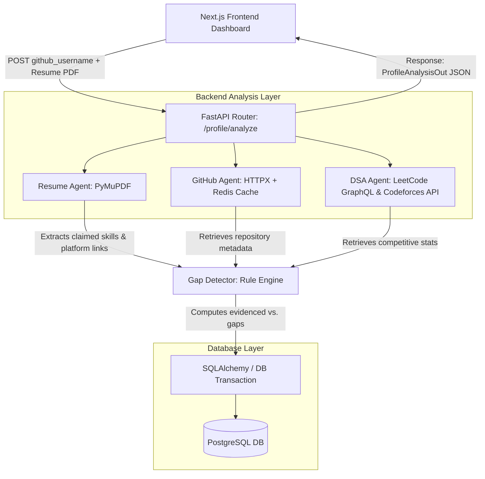

# EngineerOS — Technical Architecture & Project Guide

EngineerOS is an automated developer portfolio auditor. It takes a developer's **GitHub username** and **Resume (PDF)**, parses claimed skills and profile links, cross-references claims against actual public repo evidence and competitive programming profiles, and outputs an interactive visual **Evidence Ledger** showing verified skills, gaps, and recommendations.

---

## 1. System Architecture



### End-to-End Execution Flow
1. **Upload & Direct Extraction**: The user submits the form. The frontend calls `POST /profile/analyze`.
2. **Resume Analysis**: `resume_agent.py` opens the PDF stream using `PyMuPDF`. It extracts plain text and parses hyperlinks (recovering URLs masked under anchor text like "GitHub" or "Profile").
3. **Repository Analysis**: `github_agent.py` requests public repository metadata (up to 10 most recently updated). It fetches language distributions, and checks for files like `.github/workflows/*` (CI/CD) and `test/` folder structures (testing signals).
4. **DSA profile Fetching**: `dsa_agent.py` extracts usernames from LeetCode/Codeforces URLs and concurrently requests:
   - **LeetCode GraphQL** (fetch solved count, difficulty splits, languages).
   - **Codeforces REST API** (fetch rating, rank, solved count, topic tags, languages).
5. **Gap Detection**: `gap_detector.py` compares claimed skills against repository metrics and DSA solved stats based on a strict `EVIDENCE_MAP`.
6. **Persistence**: Truncates previous analysis history for the developer and saves fresh profiles, repositories, claims, and gaps to PostgreSQL.
7. **Render**: The dashboard visualizes repositories, charts, and profile cards with color-coded diff layouts (Green for Evidenced, Red for Gaps, Amber for Unverified).

---

## 2. Component Directory Structure

```
engineeros/
├── backend/
│   ├── app/
│   │   ├── agents/
│   │   │   ├── resume_agent.py   # PDF text/link extraction & skill matching
│   │   │   ├── github_agent.py   # GitHub repo metadata scraper with Redis cache
│   │   │   └── dsa_agent.py      # LeetCode GraphQL & Codeforces API agent
│   │   ├── services/
│   │   │   ├── gap_detector.py   # Deterministic validation rules & suggestions
│   │   │   └── narrative_advisor.py # LLM-based summary stubs (v1.5)
│   │   ├── routers/
│   │   │   ├── github.py         # Direct GitHub analysis endpoints
│   │   │   ├── resume.py         # Resume parsing endpoints
│   │   │   └── profile.py        # Main profile ingestion & fetch endpoint
│   │   ├── config.py             # Environment configuration (DB, Redis, GitHub PAT)
│   │   ├── database.py           # SQLAlchmey connection manager
│   │   ├── models.py             # SQLAlchemy Postgres relational models
│   │   ├── schemas.py            # Pydantic schemas (request/response validation)
│   │   └── main.py               # FastAPI application bootstrapping & startup
│   ├── requirements.txt          # Python dependencies (fastapi, uvicorn, PyMuPDF, httpx, redis, etc.)
│   └── docker-compose.yml        # Docker config for Postgres & Redis
├── frontend/
│   ├── app/
│   │   ├── layout.tsx            # Global metadata & IBM Plex font bindings
│   │   ├── page.tsx              # Main dashboard view
│   │   └── globals.css           # Global CSS variables & Tailwind bindings
│   ├── components/
│   │   ├── UploadForm.tsx        # File drag-drop and username input form
│   │   ├── EvidenceLedger.tsx    # Diff-style list showing claim validation outcomes
│   │   ├── SkillBreakdownChart.tsx # PieChart visualizing evidenced/gap percentages
│   │   ├── RepoGrid.tsx          # Card layout for analyzed repositories
│   │   └── DsaProfiles.tsx       # LeetCode/Codeforces stats panels with difficulty meters
│   ├── lib/
│   │   └── api.ts                # HTTP fetch clients for FastAPI backend communication
│   ├── package.json              # Next.js & React dependencies
│   └── tailwind.config.ts        # Custom theme definitions (vibrant Git-diff themed layout)
```

---

## 3. Data Schema

The database uses PostgreSQL via SQLAlchemy ORM.

### Profile Table
*Holds core developer credentials and computed stats.*
- `github_username` (String, Unique)
- `linkedin_url` (String)
- `leetcode_username` (String)
- `codeforces_username` (String)
- `leetcode_stats` (JSON) — Solved counts, difficulty breakdown (`Easy`/`Medium`/`Hard`), and languages.
- `codeforces_stats` (JSON) — Rank, rating, max rating, solved counts, top tags, and languages.
- `narrative_advice` (String) — LLM generated text.

### Repository Table
*Stores details of public repositories used as evidence.*
- `name` (String)
- `primary_language` (String)
- `languages` (JSON list)
- `topics` (JSON list)
- `description` (String)
- `has_readme` (Boolean)
- `has_ci` (Boolean)
- `has_tests` (Boolean)
- `stars` (Integer)

### ResumeClaim Table
*All skills matched from the resume PDF keyword scanner.*
- `skill` (String)
- `raw_context` (String)

### Gap Table
*Gaps generated where a claim exists in `ResumeClaim` but fails checking in `EVIDENCE_MAP`.*
- `skill` (String)
- `reason` (String)
- `suggestion` (String)

---

## 4. Integration Specifications

### LeetCode API Scraper
- **GraphQL Endpoint**: `https://leetcode.com/graphql`
- **Mechanism**: Calls `userProblemsSolved` query to obtain total accepted counts, difficulty distributions, and languages.
- **Header Mitigation**: Set `"Referer": "https://leetcode.com"` and a valid `User-Agent` to prevent requests from being blocked by anti-bot measures.

### Codeforces API Scraper
- **Endpoint**: REST endpoints `https://codeforces.com/api/user.info` and `https://codeforces.com/api/user.status`.
- **Mechanism**:
  - `user.info`: Retrieves user rating, rank, maximum rating, and maximum rank.
  - `user.status`: Extracts the 100 most recent submissions to parse unique programming languages, top problem tags, and total solved problem count.

### Gap Detector (EVIDENCE_MAP)
Verification rules mapping skills to database findings:
```python
EVIDENCE_MAP = {
    "docker": {"topics": ["docker"], "keywords": ["docker"]},
    "ci/cd": {"has_ci": True},
    "postgresql": {"topics": ["postgresql", "postgres"], "keywords": ["postgres"]},
    "react": {"languages": ["JavaScript", "TypeScript"], "topics": ["react"], "keywords": ["react"]},
    "algorithms": {"codeforces_solved": 5, "leetcode_solved": 10, "topics": ["algorithms"]},
    # Additional mappings verify languages & frameworks...
}
```

---

## 5. Setup & Running

To run the full stack locally:

### 1. Database & Cache Infrastructure
```bash
docker compose up -d
```

### 2. Backend Server
```bash
cd backend
python -m venv venv
source venv/Scripts/activate  # On macOS/Linux: source venv/bin/activate
pip install -r requirements.txt
cp .env.example .env
uvicorn app.main:app --reload
```
*Backend interactive docs will be available at `http://localhost:8000/docs`.*

### 3. Frontend Dashboard
```bash
cd frontend
npm install
cp .env.local.example .env.local
npm run dev
```
*Open `http://localhost:3000` to interact with the dashboard.*

<!-- --------- -->
Terminal 1 — Backend
unzip engineeros-v1.zip
cd engineeros

docker compose up -d
<!-- -------- -->
cd backend
pip install alembic celery redis   # add to requirements.txt too
alembic upgrade head               # creates all tables fresh

# Terminal 1
uvicorn app.main:app --reload
# Terminal 2 (Windows needs --pool=solo, Celery's default prefork doesn't work there)
celery -A app.celery_app worker --loglevel=info --pool=solo


cd backend
python3 -m venv venv
source venv/bin/activate        # Windows: venv\Scripts\activate

pip install -r requirements.txt

cp .env.example .env

uvicorn app.main:app --reload

<!-- -------- -->
Terminal 2 — Frontend
cd engineeros/frontend

npm install

cp .env.local.example .env.local

npm run dev